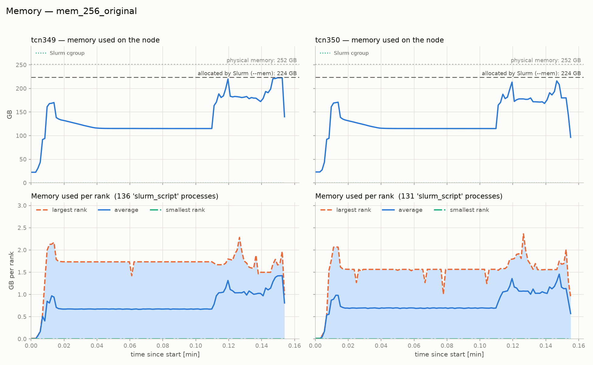
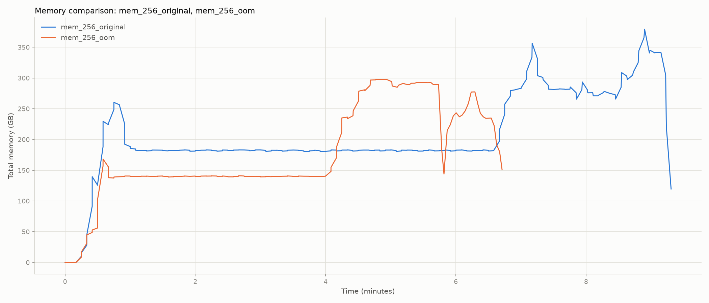

# TauREx memory profiler

Measure and plot where the memory of a TauREx run goes: per node, per MPI rank,
and per process, with optional CPU profiling and timing from the same run.

* per-process **RSS, Pss, RssAnon/RssFile/RssShmem, VmSize, VmPeak** and threads
* node memory against the **physical memory**, the Slurm **`--mem`** limit and
  the job **cgroup** counter (the number the OOM killer uses)
* one sampler per node, so multi-node runs are covered
* Pss by default, which counts MPI-shared pages (opacities) once
* 2- and many-way comparisons, per-node and top-N breakdowns, OOM detection
* optional py-spy CPU flamegraph and wall-clock/fit/sampling timing
* peak memory from `sacct` when a run had no monitor
* a shareable markdown report

Two commands, one per side of a run:

| command | module | role |
|---|---|---|
| `taurex-mem-run` | [`runner.py`](./src/taurex_memory_profiler/runner.py) | run any command with the sampler beside it — the one-liner |
| `taurex-mem-plot` | [`plot.py`](./src/taurex_memory_profiler/plot.py) | all the figures, the results comparison, the text summary and the report |
| `python -m taurex_memory_profiler.monitor` | [`monitor.py`](./src/taurex_memory_profiler/monitor.py) | the per-node sampler `taurex-mem-run` starts (also usable standalone) |

`python -m taurex_memory_profiler` is the plotter, so the package is usable even
without the console scripts on `PATH`.

Requires Python ≥ 3.9 and Linux (`/proc`); `py-spy` only if you want the CPU
flamegraph, and `h5py` only if you want the results of the compared runs drawn
(it reads their retrieval outputs). Everything else (`numpy`, `pandas`,
`matplotlib`) comes with the install.

## Install

```bash
pip install git+https://github.com/eScience-TauRex/taurex-memory-profiler
pip install "taurex-memory-profiler[pyspy] @ git+https://github.com/eScience-TauRex/taurex-memory-profiler"  # + py-spy
```

From a checkout, preferably in a virtual environment:

```bash
python3 -m venv .venv && source .venv/bin/activate
pip install -e .            # numpy, pandas, matplotlib
pip install -e ".[pyspy]"   # …plus py-spy, for the CPU flamegraph
pip install -e ".[hdf5]"    # …plus h5py, to draw the results of the compared runs
```

The sampler is started with the **same interpreter** as `taurex-mem-run`, so on a
cluster install the package into the environment the job activates and it is
available on every node through `srun`. The only thing left to decide is where
the sampler writes and reads its logs (`-o` / `--logdir`, default
`./memory_logs`).

## Quick start

```bash
# 1. monitored run: prefix your MPI command with taurex-mem-run and give it a label
taurex-mem-run -l mem_64_good -- mpirun -np 256 taurex -i parfile.par --retrieval -o output.hdf5 --light

# 2. plot the latest run in ./memory_logs
taurex-mem-plot

# 3. compare two runs by name, straight out of ./memory_logs
taurex-mem-plot --compare mem_64_good mem_64_bad
```

The runs are found by the `-l` label you gave them, so no job id and no path are
needed. Add as many names as you like (`--compare a b c`), and `--report` to also
get the tables.

---

## Running a job under the sampler: `taurex-mem-run`

```bash
taurex-mem-run [options] [--] COMMAND [ARGS...]
```

`taurex-mem-run` starts one `taurex_memory_profiler.monitor` per node, waits for
the first samples, runs your command, stops the samplers on every exit path (so
the CSVs survive an OOM kill), writes `run_<jobid>.meta`, and prints the command
to plot the result. **It returns your command's exit code unchanged**, so
`sbatch` still reports a failed or killed retrieval as such.

An existing job script changes in exactly one line:

```diff
-mpirun -np 256 taurex -i parfile.par --retrieval -o output.hdf5 --light
+taurex-mem-run -l mem_128_good -- mpirun -np 256 taurex -i parfile.par --retrieval -o output.hdf5 --light
```

Everything else — modules, venv, `#SBATCH` lines, `-np 256` — stays in your
script. A complete example:

```bash
#!/bin/bash
#SBATCH --nodes=2
#SBATCH --ntasks-per-node=128
#SBATCH --mem=224G
#SBATCH --partition=rome
#SBATCH --time=2-00:00:00
#SBATCH --output=slurm_%x_%j.out

module purge
module load 2025 foss/2025b Python/3.13.5-GCCcore-14.3.0
export LD_LIBRARY_PATH=/projects/prjs1336/Software/2026/MultiNest/lib:$LD_LIBRARY_PATH
source /projects/prjs1336/Software/2026/taurex34/bin/activate

pip install git+https://github.com/eScience-TauRex/taurex-memory-profiler  # once per environment
taurex-mem-run -l mem_128_good -- mpirun -np 256 taurex -i parfile.par --retrieval -o output.hdf5 --light
```

### Options

| option | default | meaning |
|---|---|---|
| `-o, --outdir DIR` | `memory_logs` | where the CSVs go |
| `-i, --interval SEC` | `5` | sampling interval (may be < 1) |
| `-t, --threads N` | `1` | parallel Pss readers; the monitor step also requests N CPUs |
| `-p, --pattern REGEX` | `.` | only track process names matching, e.g. `'taurex\|prterun'` |
| `-j, --jobid ID` | `$SLURM_JOB_ID` or `local` | used in the file names |
| `-l, --label NAME` | job id | label used by the plots |
| `--pyspy` | off | also record a py-spy CPU flamegraph |
| `--pyspy-rate HZ` | `100` | py-spy sampling rate |
| `--pyspy-out FILE` | `profile_<label>.svg` | py-spy output file |
| `--delete-old` | off | delete the runs that already carry this label, without asking |
| `--keep-old` | off | keep them, without asking |

### One name, one run

The label is the name of the run, so starting a second run with a label that is
already in `--outdir` would leave two runs of one name — and, since the figures
are named after the label, two runs writing the same files. Before starting,
`taurex-mem-run` therefore says which runs already carry that label and asks
whether to delete them:

```
2 runs are labelled 'mem_64_good' in memory_logs:
  28469912
Delete the 1 older one(s), so they do not clutter the plots? [y/N]
```

Answering `y` removes their CSVs, their `run_<jobid>.meta` and the figures and
report the plotter named after that label. In a batch job there is no terminal
to ask on: the runs are kept and the note says so, so a script that must not ask
can pass `--delete-old` or `--keep-old` and decide up front.

Environment: `MEM_INTERVAL`, `MEM_THREADS` and `MEM_PATTERN` seed the matching
options, `MEM_RUN_WAIT` sets how long to wait for the first samples (default
`2*interval + 2`). Under Slurm the samplers run as one overlapping `srun` step
per node, requesting `max(1, threads)` CPUs so the Pss threads can run in
parallel; without Slurm only the local node is sampled, which makes
`taurex-mem-run` usable on a login node for short tests.

**Pss is what limits a short interval.** Reading `/proc/<pid>/smaps_rollup`
walks the target's page tables and costs a few milliseconds for a rank with a
large address space, so a serial read over 64 ranks stretches `-i 0.1` to
~0.27 s. `-t 8` overlaps those reads (and asks Slurm for the 8 CPUs they need),
so `-i 0.05` is actually reached; `-t 1` keeps the old single-CPU behaviour.

### CPU profile and timing (`--pyspy`)

`--pyspy` wraps the run in `py-spy record --subprocesses` (so the MPI ranks are
followed too) and writes a flamegraph. The `Samples: N` line py-spy prints is
read back by the plotter, which puts the CPU cost next to the memory cost.
Requires `pip install py-spy`; the job fails immediately with a clear message if
it is missing. A 128-rank flamegraph is large, so use `--pyspy-out` to keep it
out of the way.

---

## Plotting: `taurex-mem-plot`

```bash
taurex-mem-plot [RUN ...] [options]     # or: python -m taurex_memory_profiler
```

### Choosing what to plot

| you have | command |
|---|---|
| one log directory, most recent run | `taurex-mem-plot` |
| two (or more) runs by name in one directory | `taurex-mem-plot --compare mem_64_good mem_64_bad` |
| several runs picked by pattern | `--select 'mem_64_*'` |
| one specific job in a directory | `--job 12345` |
| one directory per run | `good=logs_good --compare bad=logs_bad` |
| individual CSVs | `mem_64.csv --compare mem_64_bad.csv` |
| only an `sacct` dump | `sacct_26968927.txt` |

A `RUN` is one of:

| form | example | meaning |
|---|---|---|
| name | `mem_64_good` | the run labelled `mem_64_good` in `--logdir` |
| file | `mem_64.csv` | one CSV, or an `sacct` dump |
| directory | `logs_good` | most recent run there (or `--job`/`--select`) |
| `LABEL=path[#jobid]` | `good=logs#12345` | explicit path and job, shown as `good` |

A **name** is matched against the `label=` in `run_<jobid>.meta`, which is what
`taurex-mem-run -l` writes, so the name you submitted the job with is the name
you plot it with. `--select GLOB` does the same but keeps every match, so
`--select 'mem_64_*'` overlays a whole row of a grid in one command. With no
`RUN` the tool scans `--logdir` (default `memory_logs`) and uses the most recent
job unless `--job` or `--select` is given.

### Options

| option | meaning |
|---|---|
| `--compare RUN` | overlay another run, by name or path (repeatable, several at once) |
| `--compare2 RUN` | third run (shorthand) |
| `--labels A B ...` | labels of the runs, in the order the runs are given (repeatable) |
| `--label NAME`, `--label-a/-b/-c NAME` | a label for one run (`-a/-b/-c` are the legacy names) |
| `--job ID` | one job inside a log directory |
| `--select GLOB` | every run in the directory whose label or job id matches |
| `--logdir DIR` | directory scanned when no RUN is given |
| `--rss` | plot RSS instead of Pss |
| `--command NAME` | only use these processes for the per-rank statistics |
| `--limit-gb GB` | Slurm `--mem` per node, drawn as a reference line [224] |
| `--project-ranks N` | ranks/node for the memory extrapolation [128] |
| `--per-node` | also draw one line per node |
| `--top N` | also draw the top-N processes by peak memory |
| `--per-run` | with several runs, also write the per-run figures (implied by `--compare`) |
| `--report PATH` | also write a markdown report (peaks, limits, timings) |
| `--title TEXT` | custom title for the comparison figure |
| `--output [LABEL=]FILE` | the output of a compared run, when it is not the `-o` recorded in `run_<jobid>.meta` |
| `--no-results` | do not draw the results of the compared runs |
| `--output-dir DIR` | where to write the figures |
| `--killed` / `--not-killed` | force the OOM marker instead of auto-detecting it |
| `--delete-old` / `--keep-old` | what to do when several runs share a name: delete the older ones, or keep them, without asking |

Two runs with the same name would write the same figures, so when the name of a
run appears on another run in its log directory only the most recent one is
plotted and the older ones are offered for deletion (their logs, their
`run_<jobid>.meta` and the figures named after that label). That also happens
when a single job is picked with `--job` or by taking the newest run of the
directory: the other runs of its name are what would overwrite its figures.
Without a terminal to ask on the older runs are kept, and the note says so.

### What you get

Figures (PNG) are written next to the logs, in the current directory when
the runs come from several directories, or wherever `--output-dir` points:

* `memory_<label>.png` — overview, one column per node (below).
* `memory_<label>_total.png` — total memory over time (all ranks, all nodes).
* `compare_<a>_vs_<b>[_vs_...].png` — overlay of the memory of the runs, with a peak table.
* `compare_spectra_<a>_vs_...png`, `compare_contributions_...`, `compare_tp_profiles_...`,
  `compare_mixratios_...`, `compare_posteriors_...` — one figure per quantity, every run on
  the same axes (below).
* `memory_<label>_peak.png` — bar chart of the peak, for runs that only have an
  `sacct` dump.
* `memory_<label>_per_node.png`, `memory_<label>_top<N>.png` — optional breakdowns.

Typical output, comparing two 2-node runs of 256 ranks:


*`memory_<label>.png` — one column per node: memory used (Pss) against the
physical memory, the Slurm `--mem` allocation and the cgroup counter, with the
per-rank smallest/average/largest underneath.*


*`compare_<a>_vs_<b>.png` — the runs overlaid, with the peak table.*

The `compare_*` figures of the results are one figure per quantity — spectrum,
contributions, temperature profile, mixing ratios, posteriors — and every figure
holds all the runs on one axes, one curve per run, so the approaches are read
against each other. No extra directory is written: the figures go where the
other figures go.

With `--compare`, every compared run gets its own `memory_<label>.png` and
`memory_<label>_total.png` first, so each run can be read on its own and the
`compare_*.png` overlay is written last. `--per-run` does the same for several
runs that were not given with `--compare`.

The [results comparison](#compare-the-results) runs first: every output is read
and its curves go into the `compare_*` result figures.

The text summary and the report give the peak total, the peak per node (next to
the `--mem` limit), the per-rank statistics with the extrapolation to
`--project-ranks` ranks per node, and — when the job log is next to the run — the
wall clock, TauREx runtime, `optimizer.fit()`, MultiNest sampling and the py-spy
CPU sample count.

### Peaks without a monitor (`sacct`)

If a run has no sampler CSV (the monitor was not running, or you only have the
job id), use the Slurm accounting:

```bash
sacct -j 26968927 -P --format=JobID,Elapsed,MaxRSS,MaxVMSize,AveRSS > sacct_26968927.txt
taurex-mem-plot sacct_26968927.txt --compare mem_64_good
```

The dump is detected by its `MaxRSS` column; it contributes a peak to the
summary, the report and the comparison figure. A bare number is read as KiB,
which is what `sacct` reports.

---

## Comparing runs

Comparing is two steps: give each run a name, then plot the names together.

### 1. Name the run

Pass `-l NAME` to `taurex-mem-run`, and let every run write to the same output
directory (default `memory_logs`):

```bash
taurex-mem-run -l mem_64_good -- mpirun -np 128 taurex -i parfile.par --retrieval -o output.hdf5 --light
```

The name is stored in `run_<jobid>.meta` next to the CSVs, so it survives long
after you have forgotten the job id.

### 2. Plot the names

```bash
# compare two runs that both live in ./memory_logs
taurex-mem-plot --compare mem_64_good mem_64_bad

# keep the tables too
taurex-mem-plot --compare mem_64_good mem_64_bad \
    --report memory_logs/report_good_vs_bad.md
```

That is the whole interface: `--compare` takes run names, as many as you like,
and each one is looked up in `--logdir`. Use `LABEL=PATH` instead of a name when
the run lives somewhere else, e.g. `--compare bad=logs_bad` or
`--compare bad=logs_bad#12345` (a third run goes under `--compare2`, or just list
it in the same `--compare`). The first run can be a name too:

```bash
taurex-mem-plot mem_64_good --compare mem_64_bad
```

Labels on the figures default to the run names, so the plot is readable without
renaming anything afterwards. To name the runs yourself, give `--labels` the
same number of labels as there are runs, in the order the runs are given
(positional runs first, then `--compare`, then `--compare2`):

```bash
# the legend reads "OOM branch" and "original taurex3" instead of the file names
taurex-mem-plot mem_64.csv --compare mem_64_bad.csv \
    --labels "OOM branch" "original taurex3"
```

A `LABEL=PATH` in the run itself still wins over `--labels`, so a single run can
be renamed where it is written. Runs without a label keep their default name.
Each compared run is plotted on its own first
(`memory_<name>.png` and `memory_<name>_total.png`), and the `compare_*.png`
overlay is written last.

### Picking runs by pattern

If you name the runs of a grid after their axes — `mem_64_good`, `mem_64_bad`,
`mem_128_good` — you can select a whole row with a glob, instead of listing the
names:

```bash
# every run whose name starts with mem_64_
taurex-mem-plot --select 'mem_64_*'

# the whole grid in one table
taurex-mem-plot --select 'mem_*' --report memory_logs/report_grid.md
```

`--select` accepts names and job ids, and combines with `--logdir`. A grid that
varies the node layout is just the same job script submitted with different
`--nodes`/`--ntasks-per-node` and `-l`. One report per axis value, e.g. for a
scaling study:

```bash
for cfg in 32 64 128; do
    taurex-mem-plot --select "mem_${cfg}_*" \
        --title "${cfg} ranks/node" --report "memory_logs/report_${cfg}.md"
done
```

### Compare the results

Memory is only comparable if the runs did the same work, so every `--compare`
also draws the results the way a retrieval is read. `taurex-plot` writes one
figure per output and cannot overlay them, so the tool reads the same arrays from
the outputs and draws one figure per quantity, each with every run on one axes,
one curve per run:

| figure | what is plotted |
|---|---|
| `compare_spectra_*.png` | the observation once, and each run's binned model spectrum on top of it |
| `compare_contributions_*.png` | each opacity source's own spectrum (the spectrum with that source alone, so the sources are not summed), once per run |
| `compare_tp_profiles_*.png` | temperature against pressure, with ±1σ, per run |
| `compare_mixratios_*.png` | the active gases against pressure, per run |
| `compare_posteriors_*.png` | the sampled posterior of every fitted parameter, one histogram per run |

The figures keep the `taurex-plot` style — same sizes, axis labels, scales, the
`Paired` colours, the ±1σ/±2σ spectrum bands and the same legend placement — so a
comparison figure reads like the plot of one output, with the other runs added.
In the spectrum, temperature and posterior figures the colour is the run; in the
contributions and mixing-ratios figures the colour is the source or the gas, as in
`taurex-plot`, and the line style distinguishes the runs (solid, dashed,
dash-dot), with a second legend for it.

The output is the `-o` of the command recorded in each run's `run_<jobid>.meta`,
looked up next to the logs and one directory up; the runs do not have to share
the file name. Point at it when the run was started outside `taurex-mem-run`:

```bash
taurex-mem-plot --compare mem_256_original mem_256_oom \
    --output mem_256_original=output.hdf5 --output mem_256_oom=output_oom.hdf5
```

A `[LABEL=]FILE` applies to that run, a plain `FILE` to every run;
`--no-results` skips the comparison.

This needs `h5py` and a retrieval that *ran to the end*: `--light` writes only
`ModelParameters`, and such an output is named and skipped (for a run that is
meant to finish, drop `--light`: `LIGHT=0 ./submit.sh 2 64 50`). When the
`-o` of a run is `--light`, the plotter looks for a finished output with the
same file name next to the logs and in `tmp_postprocess/` — which is where
`submit_postprocess.sh` writes the chain it finishes — and says which file it
drew instead of the light one. Nothing is
written into the log directory apart from the figure itself.

### Read the comparison

* **Peak per node against `--mem`** is the headline: it tells you whether the run
  fits and how much headroom is left. The cgroup line is what the OOM killer
  actually watches.
* **Pss, not RSS**, sizes `--mem` — RSS double-counts shared MPI pages.
* **Per-rank largest vs average** shows imbalance: a few heavy ranks can push a
  node over the limit while the average looks fine.
* **The extrapolation** (`--project-ranks`) estimates the node footprint at a
  different rank count, assuming memory scales with the ranks; use it to pick a
  layout, then confirm with a real run.
* **The report** puts memory and timing side by side, which is what you need to
  choose between environments — a run is only better if it is not slower.

### Share it

The `--report` markdown plus the PNG figures are self-contained: they list
the runs, the peaks against the limit, the relative differences, the timings and
the per-node table, next to the memory and results comparisons. Copy them next to
the logs, or commit them with the results.

---

## The sampler: `python -m taurex_memory_profiler.monitor`

Normally you never call this directly; `taurex-mem-run` does, once per node. Run
it standalone to attach the sampler to something already running:

```bash
python -m taurex_memory_profiler.monitor [-o OUTDIR] [-i INTERVAL] [-p PATTERN] [-j JOBID]
```

| option | default | meaning |
|---|---|---|
| `-o, --outdir` | `memory_logs` (`$MEM_OUTDIR`) | where the CSVs go |
| `-i, --interval` | `5` (`$MEM_INTERVAL`) | seconds between samples, may be < 1 |
| `-t, --threads` | `1` (`$MEM_THREADS`) | threads reading Pss in parallel; >1 needs the CPUs free |
| `-p, --pattern` | `.` (`$MEM_PATTERN`) | only track process names matching this regex |
| `-j, --jobid` | `$SLURM_JOB_ID` or `local` | used in the file names |

Stop it with `SIGTERM`/`SIGINT`, or (from another shell) by creating
`<outdir>/.stop_<jobid>` — that file is also how `taurex-mem-run` stops every
node at once.

It writes, per node:

```
memory_logs/memory_<jobid>_<node>.csv        one row per process per sample
memory_logs/node_memory_<jobid>_<node>.csv   one row per node per sample
```

Process columns: `timestamp,node,pid,ppid,command,rss_kb,pss_kb,vsz_kb,vmpeak_kb,`
`data_kb,threads,rss_anon_kb,rss_file_kb,rss_shmem_kb,elapsed_s`.

Node columns: `timestamp,node,mem_total_kb,mem_available_kb,mem_used_kb,`
`mem_used_percent,cgroup_mem_kb,swap_used_kb,shmem_kb,load1,load5,load15,`
`user_procs,user_rss_kb,user_pss_kb,user_rss_anon_kb,elapsed_s`.

The CSVs are written and flushed sample by sample, so they survive an OOM kill.

> Keep the interval sane: 5 s over 48 h and 128 ranks is ~300 MB per node, while
> 0.01 s would be ~100 GB. Sub-second sampling is only for short runs.

---

## Troubleshooting

* **"no memory logs found"** — the sampler writes to `memory_logs/` relative to
  the job's working directory. Pass the right one with `--logdir` (or `-o` when
  sampling).
* **A run has no timing rows** — timing comes from the Slurm log; make sure
  `#SBATCH --output` writes `slurm_<jobname>_<jobid>.out` in the submit
  directory, as the example does.
* **No comparison figure** — a single run gives the overview and total figures; a
  comparison needs two or more runs.
* **No results comparison** — the tool names the run and the reason: no output
  file recorded in its `run_<jobid>.meta` (pass `--output [LABEL=]FILE`), or a
  `--light` output with no finished output of the same name in the directories
  it searches. `--no-results` skips the comparison.
* **`--select` matches nothing** — it matches the label from
  `run_<jobid>.meta` or the job id; the error lists what is available.
* **`pss_kb` is 0 for some processes** — `/proc/<pid>/smaps_rollup` was not
  readable for them (usually processes of another user). The plotter falls back
  to RSS only when the whole column is empty.
* **OOM not marked** — detection scans the `*.out` logs next to the run for
  `oom_kill` / `Out of memory`, and for the run's own `Exit code: 137` / `-9`
  line (Slurm does not always write the `oom_kill` summary); use `--killed` when
  the log is elsewhere.
* **`taurex-mem-run` not found** — install the package into the environment the
  job activates, *before* the `taurex-mem-run` line, so `PATH` is set up by the
  time Slurm runs the job.
* **`No module named taurex_memory_profiler` in the sampler output** — the
  environment is not visible from the other nodes; install into a shared
  filesystem (`/projects`, `/home`) rather than a node-local one.

---

## Development

```bash
pip install -e ".[tests]"
pytest                       # or, no test runner needed:
python tests/test_plot.py
python tests/test_monitor.py
python tests/test_runner.py
```

The checks call the command line, so they exercise exactly what a user types;
`tests/_helpers.py` puts `src/` on `PYTHONPATH`, which makes a plain checkout
work uninstalled. CI runs them on Python 3.9 and 3.13.

```
src/taurex_memory_profiler/
    monitor.py   per-node sampler: reads /proc, writes the two CSVs
    runner.py    taurex-mem-run: starts the samplers and runs the command
    plot.py      taurex-mem-plot: figures, results comparison, summary and report
    runs.py      the files a run leaves behind, and the pruning of old namesakes
docs/            the figures shown above, from a 2-node 256-rank comparison
```
